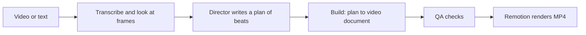

# Saymo

Turn a recording or a few lines of text into a ready-to-post social video.

The user uploads a video or writes what they need and presses one button. A director, a Claude model, writes a plan of beats; the plan becomes a video document, plain JSON rather than code; and [Remotion](https://www.remotion.dev) renders the document to MP4 with cuts, zooms, captions and motion graphics in the brand's style. Edits are made in words: "Claude Code, but for videos".

> **Status: early development.** The rendering pipeline and the video vocabulary work locally; the web app has sign-in with an email link and an account, and the rest of it, plans and billing included, is not built yet. See [Where it stands](#where-it-stands).

## How it works



- **The video is data.** The director never writes code: it returns a plan checked against a Zod schema, and a deterministic build turns it into a document of scenes and elements. Layout for 9:16, 1:1 and 16:9 is computed from that document.
- **A vocabulary, not templates.** A frame is composed from primitives: kinetic titles, counters, chips, accents, media pieces, transitions, compositions of the frame, palettes for videos without a brand, ten backdrops with a camera that moves over them and two complete styles. See [Vocabulary](docs/vocabulary.md).
- **Three entry modes** come from one pipeline: your footage with graphics, text only, and minimal captions and cuts.

## Where it stands

- Done: the scaffold and the pipeline spike (transcription, frame notes, director, build, QA, local and Lambda rendering).
- In progress: the vocabulary base and variety across videos; the plan is in [Vocabulary](docs/vocabulary.md#variety-across-videos).
- In progress: the application, slice by slice. Slice 1, the foundation and sign-in (Next.js, Postgres, an email link), is built; the main path on a mock engine is next. See the [design spec](docs/superpowers/specs/2026-10-28-saymo-v1-design.md).

## Stack

TypeScript and Node 22 · Remotion 4 and ffmpeg · Zod · Claude through the Anthropic SDK · ElevenLabs and Deepgram for speech · AWS Rekognition for faces · Remotion Lambda · Vitest and Biome · VitePress for the docs. The planned app stack is in [Architecture](docs/architecture.md#stack).

## Getting started

Requirements: Node 22 (pinned in `.nvmrc`), pnpm through Corepack, and ffmpeg on `PATH`.

```bash
nvm use
corepack enable
pnpm install
```

Render a video from a hand-written plan, locally and with no API keys:

```bash
pnpm render:plan fixtures/plan.compositions.json --out runs/composition-lab --style bold-pop
```

The MP4 lands in `runs/composition-lab/out.mp4`. To run the full pipeline on your own video or text, copy `.env.example` to `.env`, fill in the keys from [Setup](docs/runbooks/setup.md) and see [Pipeline](docs/pipeline.md).

## Run the app

The app needs a Postgres database and a mail inbox. Install Mailpit (`brew install mailpit`), put `DATABASE_URL`, `BETTER_AUTH_SECRET` and `BETTER_AUTH_URL` in `.env` (see [Setup](docs/runbooks/setup.md#run-the-app)), then:

```bash
pnpm db:migrate
pnpm dev
```

The app is on `http://localhost:3000` and the sign-in emails land in Mailpit at `http://localhost:8025`. `pnpm e2e` runs the end-to-end test.

## Commands

| Command | What it does |
| --- | --- |
| `pnpm check` | Biome: lint and formatting |
| `pnpm typecheck` | TypeScript, `tsc --noEmit` |
| `pnpm test` | Vitest |
| `pnpm spike <video>` or `pnpm spike --text "..."` | The full pipeline; the director runs locally by default and the run resumes with `--resume --run <id>` |
| `pnpm render:plan <plan.json> --out <dir>` | Build, check and render a plan locally |
| `pnpm remotion:studio` | Remotion Studio, to preview compositions |
| `pnpm remotion:lab` | Render the motion, type, accent, media and transition labs |
| `pnpm dev` | The app and Mailpit |
| `pnpm build` | The production build of the app |
| `pnpm db:generate`, `pnpm db:migrate` | Write and apply database migrations |
| `pnpm e2e` | The end-to-end test in Playwright |
| `pnpm docs:dev` | The documentation site, locally |

## Project structure

```
src/
  app/       Next.js routes, thin
  features/  slices: auth, account, emails, generation, landing
  ui/        design system: tokens and primitives
  video/     schema, layout, compositions, motion, styles, fonts, QA and the Remotion components
  worker/    pipeline steps: ingest, transcribe, see, direct, build
  lib/       thin infrastructure: env, db, email, i18n, ffmpeg, AI clients
  cli/       the spike and the render commands
messages/    interface strings
drizzle/     database migrations
e2e/         end-to-end tests
docs/        documentation, built into a VitePress site
fixtures/    sample plans and documents
public/      the font library
```

## Documentation

The docs live in [`docs/`](docs) and build into a site with `pnpm docs:dev`.

- [Overview](docs/overview.md): what we build and for whom
- [Pipeline](docs/pipeline.md): from upload to MP4
- [Video schema](docs/video-schema.md): the video as data
- [Vocabulary](docs/vocabulary.md): the primitives a frame is built from
- [Architecture](docs/architecture.md): the app, folders and stack
- [Decisions](docs/product/decisions.md): why things are the way they are
- [Design spec](docs/superpowers/specs/2026-10-28-saymo-v1-design.md): the main document

Working rules for contributors, people and AI agents alike, are in [CLAUDE.md](CLAUDE.md).

## License

No license has been chosen yet, so all rights are reserved. The fonts in `public/fonts` are under the SIL Open Font License 1.1, each with its license file.
