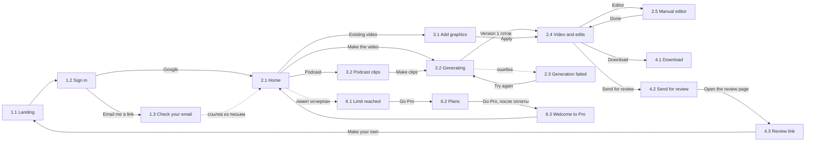

# Дизайн-хендофф: [name], сервис моушн-роликов

Обновлено 21 октября 2026. Источник: холст в Claude, «Сервис моушн-роликов для маркетологов» (доступ только у владельца). Если холст и эти файлы разошлись, верен холст: попроси владельца выгрузить свежую версию.

Что это за продукт и зачем, описано в `docs/` проектного хендоффа. Здесь только то, как он выглядит и ведёт себя.

## Что в папке

| Файл | Что это |
| --- | --- |
| `foundations.md` | Цвета, шрифты, отступы, радиусы, размеры, тени, иконки, тон текста |
| `tokens.css`, `tokens.json` | Те же значения в виде переменных |
| `components.md` | Компоненты: из чего собраны экраны, размеры, варианты, состояния |
| `screens.md` | Все 20 экранов: что на экране, что делает каждый элемент, куда ведёт |
| `foundations.png` | Борд Foundations целиком |
| `screens/png/` | Скриншоты экранов, 1280 px по ширине |
| `screens/html/` | Те же экраны и Foundations в HTML. Открываются в браузере, ссылки между экранами работают |

## Как читать

- **PNG** показывает, как выглядит экран. **HTML** даёт точные значения: все стили в нём inline. **screens.md** описывает поведение, которого на картинке не видно.
- HTML — это макет, а не код продукта. Кнопки ничего не делают, данные выдуманы, стили не организованы. Брать из него размеры и отступы, но не копировать разметку как есть.
- Если картинка и текст расходятся, верны `foundations.md` и токены. О расхождении стоит сказать владельцу.
- Все макеты нарисованы под десктоп шириной 1280. Отдельных мобильных макетов нет, см. раздел «Чего нет в макетах».
- Язык интерфейса английский. Документы на русском.

## Принципы

1. **Тёмная сцена, один громкий акцент, крупный плотный шрифт.** Главный на экране ролик, интерфейс отступает.
2. **Один акцент на экран.** Акцентный цвет только у главного действия, выделения, прогресса и плейхеда.
3. **Цвета бренда пользователя живут только внутри роликов.** Интерфейс их не использует.
4. **Всё можно попросить словами.** Кнопки нужны только для самых частых действий, остальное через поле правки.
5. **Выбирать глазами, а не настраивать.** Три готовых варианта вместо панели параметров.
6. **Без тупиков.** После каждого шага экран предлагает два-три следующих.
7. **Ручной монтаж спрятан.** Вход в него через неприметную ссылку Editor, внутри только порядок, длина и текст сцен.
8. **Никаких моделей, режимов и кредитов в интерфейсе.** Пользователь видит только ролики и сколько их осталось.

## Карта экранов

| № | Экран | Файл | Флоу |
| --- | --- | --- | --- |
| 1.1 | Landing | `1-1-landing` | Вход и настройка |
| 1.2 | Sign in | `1-2-sign-in` | Вход и настройка |
| 1.3 | Check your email | `1-3-check-email` | Вход и настройка |
| 1.4 | Brand setup | `1-4-brand-setup` | Вход и настройка |
| 2.1 | Home | `2-1-home` | Сделать ролик |
| 2.2 | Generating | `2-2-generating` | Сделать ролик |
| 2.3 | Generation failed | `2-3-generation-failed` | Сделать ролик |
| 2.4 | Video and edits | `2-4-video-and-edits` | Сделать ролик |
| 2.5 | Manual editor | `2-5-manual-editor` | Сделать ролик |
| 3.1 | Add graphics to a video | `3-1-add-graphics` | Из своего материала |
| 3.2 | Podcast clips | `3-2-podcast-clips` | Из своего материала |
| 4.1 | Download (окно) | `4-1-download` | Скачать и отправить |
| 4.2 | Send for review (окно) | `4-2-send-for-review` | Скачать и отправить |
| 4.3 | Review link | `4-3-review-link` | Скачать и отправить |
| 5.1 | My videos | `5-1-my-videos` | Библиотека и аккаунт |
| 5.2 | My videos, empty | `5-2-my-videos-empty` | Библиотека и аккаунт |
| 5.3 | Account | `5-3-account` | Библиотека и аккаунт |
| 6.1 | Limit reached (окно) | `6-1-limit-reached` | Тарифы и оплата |
| 6.2 | Plans | `6-2-plans` | Тарифы и оплата |
| 6.3 | Welcome to Pro | `6-3-welcome-to-pro` | Тарифы и оплата |

## Как экраны связаны

Шапка приложения есть на Home, Brand setup, My videos, Account, Plans и Welcome to Pro: Your brand ведёт на 1.4, My videos на 5.1, иконка профиля на 5.3. Пунктиром отмечены переходы, которые происходят не по кнопке.

## Заглушки

На макетах это не настоящие данные, их нужно заменить или решить:

- `[name]` — название продукта, ещё не выбрано.
- `$[price]` — цена Pro, не выбрана.
- `[date]` — дата обновления лимита и продления подписки.
- `[error id]`, `[support email]` — номер ошибки и адрес поддержки.
- `[your name]`, `[sender name]`, `[customer name, company]`, `[speaker name]`, `[role, company]`, `[host name]`, `[guest name]` — имена людей.
- `you@company.com`, `[name].app/r/7Kq2xV` — пример почты и ссылки.
- «Launch: reports in PDF», «interview.mp4», «episode-12.mp3», цифры вроде «14 of 20» и «64%» — примеры содержимого.
- Синий, жёлтый и прочие цвета внутри роликов — демо-бренд, см. `foundations.md`.

## Чего нет в макетах

Это нужно спроектировать или решить при вёрстке. Пункты с пометкой «предложение» — мой вариант, его можно менять.

- **Телефон.** Экраны резиновые и переносятся по строкам, но отдельных мобильных макетов нет. Правило на телефоне: боковые поля 16 px, колонки встают друг под друга.
- **Наведение и фокус.** Не нарисованы. Предложение: при наведении фон на шаг светлее по шкале поверхностей; фокус с клавиатуры — обводка 2 px акцентом с отступом 2 px.
- **Отмена правки (Undo).** Есть в скоупе, на экране 2.4 не нарисована.
- **Правка всего ролика**, когда ничего не выделено (на 2.4 нарисовано состояние с выделенным заголовком).
- **Выделение других элементов кадра:** логотип, кнопка, фон, музыка, озвучка.
- **Результат Fetch brand:** показать найденные логотип, цвета и шрифт и дать их поправить перед сохранением.
- **Загрузка своего видео и подкаста:** прогресс, ошибки, ограничения по длине и размеру.
- **Короткие уведомления** («ссылка скопирована», «сохранено») и скелетоны загрузки в My videos.
- **Действия с роликом в My videos:** переименовать, дублировать, удалить (с подтверждением).
- **Подтверждение удаления аккаунта.**
- **Водяной знак** на роликах тарифа Free.
- **Письма:** ссылка для входа, чек, неудачный платёж, «ролик готов».
- **Оплата:** страница оплаты платёжного сервиса и неудачный платёж.
- **Ссылка на согласование выключена** или не существует; страница 404.
- **Светлая тема** не планируется.
