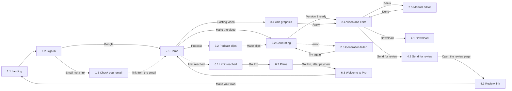

# Design handoff: [name], a motion video service

Updated 21 October 2026. Source: a canvas in Claude, "Motion video service for marketers" (only the owner has access). If the canvas and these files disagree, the canvas is the source of truth: ask the owner to export a fresh version.

What the product is and why it exists is described in `docs/` of the project handoff. This folder covers only how it looks and behaves.

## What is in the folder

| File | What it is |
| --- | --- |
| `foundations.md` | Colors, fonts, spacing, radii, sizes, shadows, icons, tone of voice |
| `tokens.css`, `tokens.json` | The same values as variables |
| `components.md` | Components: what the screens are built from, sizes, variants, states |
| `screens.md` | All 20 screens: what is on the screen, what each element does, where it goes |
| `foundations.png` | The whole Foundations board |
| `screens/png/` | Screenshots of the screens, 1280 px wide |
| `screens/html/` | The same screens and Foundations in HTML. They open in a browser, and the links between screens work |

## How to read it

- **PNG** shows how a screen looks. **HTML** gives exact values: all styles in it are inline. **screens.md** describes behavior that the picture does not show.
- The HTML is a mockup, not product code. Buttons do nothing, the data is made up, the styles are not organized. Take sizes and spacing from it, but do not copy the markup as it is.
- If the picture and the text disagree, `foundations.md` and the tokens are right. Tell the owner about the discrepancy.
- All mockups are drawn for a desktop screen 1280 wide. There are no separate mobile mockups. See the section "What is missing from the mockups".
- The interface language is English. These documents are in English too.

## Principles

1. **A dark stage, one loud accent, a large dense font.** The video is the main thing on the screen, and the interface steps back.
2. **One accent per screen.** The accent color is used only for the main action, selection, progress and the playhead.
3. **The user's brand colors live only inside videos.** The interface does not use them.
4. **Everything can be asked for in words.** Buttons exist only for the most frequent actions, and the rest goes through the edit composer.
5. **Choose by eye, do not configure.** Three ready variants instead of a panel of settings.
6. **No dead ends.** After every step the screen offers two or three next ones.
7. **The manual editor is hidden.** The way in is an unobtrusive Editor link, and inside there are only the order, length and text of scenes.
8. **No models, modes or credits in the interface.** The user sees only videos and how many are left.

## Screen map

| No. | Screen | File | Flow |
| --- | --- | --- | --- |
| 1.1 | Landing | `1-1-landing` | Sign-in and setup |
| 1.2 | Sign in | `1-2-sign-in` | Sign-in and setup |
| 1.3 | Check your email | `1-3-check-email` | Sign-in and setup |
| 1.4 | Brand setup | `1-4-brand-setup` | Sign-in and setup |
| 2.1 | Home | `2-1-home` | Make a video |
| 2.2 | Generating | `2-2-generating` | Make a video |
| 2.3 | Generation failed | `2-3-generation-failed` | Make a video |
| 2.4 | Video and edits | `2-4-video-and-edits` | Make a video |
| 2.5 | Manual editor | `2-5-manual-editor` | Make a video |
| 3.1 | Add graphics to a video | `3-1-add-graphics` | From your own material |
| 3.2 | Podcast clips | `3-2-podcast-clips` | From your own material |
| 4.1 | Download (modal) | `4-1-download` | Download and send |
| 4.2 | Send for review (modal) | `4-2-send-for-review` | Download and send |
| 4.3 | Review link | `4-3-review-link` | Download and send |
| 5.1 | My videos | `5-1-my-videos` | Library and account |
| 5.2 | My videos, empty | `5-2-my-videos-empty` | Library and account |
| 5.3 | Account | `5-3-account` | Library and account |
| 6.1 | Limit reached (modal) | `6-1-limit-reached` | Plans and payment |
| 6.2 | Plans | `6-2-plans` | Plans and payment |
| 6.3 | Welcome to Pro | `6-3-welcome-to-pro` | Plans and payment |

## How the screens connect

The app bar is on Home, Brand setup, My videos, Account, Plans and Welcome to Pro: Your brand goes to 1.4, My videos to 5.1, the profile icon to 5.3. Dashed arrows mark transitions that do not happen from a button.

## Placeholders

In the mockups these are not real data. They need to be replaced or decided:

- `[name]`: the product name, not chosen yet.
- `$[price]`: the Pro price, not chosen.
- `[date]`: the date the limit refreshes and the subscription renews.
- `[error id]`, `[support email]`: the error number and the support address.
- `[your name]`, `[sender name]`, `[customer name, company]`, `[speaker name]`, `[role, company]`, `[host name]`, `[guest name]`: people's names.
- `you@company.com`, `[name].app/r/7Kq2xV`: an example email and link.
- "Launch: reports in PDF", "interview.mp4", "episode-12.mp3", numbers like "14 of 20" and "64%": examples of content.
- The blue, yellow and other colors inside videos: the demo brand, see `foundations.md`.

## What is missing from the mockups

These need to be designed or decided during implementation. Items marked "proposal" are my version and can be changed.

- **Phone.** The screens are fluid and wrap to new lines, but there are no separate mobile mockups. The rule for phones: 16 px side padding, columns stack one under another.
- **Hover and focus.** Not drawn. Proposal: on hover, the background goes one step lighter on the surface scale; keyboard focus is a 2 px accent outline with a 2 px offset.
- **Undoing an edit (Undo).** In scope, but not drawn on screen 2.4.
- **Editing the whole video** when nothing is selected (on 2.4 the state with the headline selected is drawn).
- **Selecting other elements of the frame:** logo, button, background, music, voiceover.
- **The Fetch brand result:** show the logo, colors and font that were found, and let the user correct them before saving.
- **Uploading your own video and podcast:** progress, errors, restrictions on length and size.
- **Short notifications** ("link copied", "saved") and loading skeletons in My videos.
- **Actions on a video in My videos:** rename, duplicate, delete (with confirmation).
- **Confirming account deletion.**
- **Watermark** on Free plan videos.
- **Emails:** sign-in link, receipt, failed payment, "video ready".
- **Payment:** the payment page of the payment service and a failed payment.
- **A review link that is turned off** or does not exist; a 404 page.
- **Light theme** is not planned.
