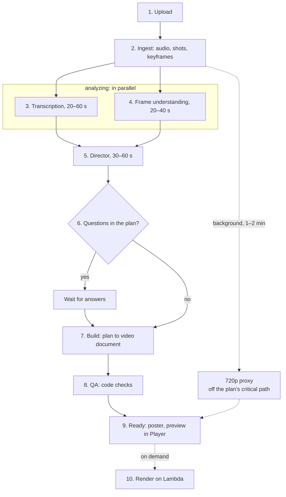

# Pipeline

Summary of section 7 of the [design spec](/superpowers/specs/2026-10-28-saymo-v1-design). Timings are for a 5-minute source.

## Job states

Every video is a job on the server:

```
queued → ingesting → analyzing → planning → awaiting_answers → building → checking → ready
```

A job can move to `failed` at any step. In `analyzing`, transcription and frame understanding run in parallel. Every step is idempotent: it writes artifacts to S3 and the database and restarts from the point of failure. The interface subscribes to the job state, so nothing is lost on a page reload.

## Ten steps

| # | Step | What happens | Timing |
| --- | --- | --- | --- |
| 1 | Upload | Straight to S3 in parts, with resume. ffprobe checks that it is a video within the length limit | |
| 2 | Ingest | Fast part first: audio track, shot boundaries, keyframes. Then in the background: normalized source and 720p proxy | seconds, background 1–2 min |
| 3 | Transcription | Words with timestamps, speakers, language. ElevenLabs Scribe or Deepgram, chosen in the spike | 20–60 s |
| 4 | Frame understanding | Faces and people per frame (ONNX or AWS Rekognition, chosen in the spike), keyframe descriptions from Claude. Result: the content map | 20–40 s |
| 5 | Director | Waits for steps 3 and 4. Claude writes the plan from the transcript and the content map. In text mode the input is the text and the linked page | 30–60 s |
| 6 | Questions | If the plan has questions, the job waits in `awaiting_answers`. Answers merge into the plan; the director is not called again if they match the defaults | waits for the user |
| 7 | Build | Deterministic: plan to video document. Voice from ElevenLabs when needed, scenes fit the speech, captions come from word timings | seconds plus voice |
| 8 | QA | Code checks: text fits, durations add up, contrast, safe zones, keep-out zones around faces, valid schema | milliseconds |
| 9 | Ready | Poster frame on Lambda. The browser preview plays the document in Remotion Player over the proxy, no render needed | |
| 10 | On-demand render | On Lambda, for download and for the review link. One format is one layout and one render | on demand |

The plan appears 1–2 minutes after upload and the video is ready in 2–4 minutes. Text mode: plan in 30–60 s, video in 1–2 minutes.

## Step diagram

Transcription and frame understanding run in parallel. The 720p proxy is built in the background, so it is off the critical path of the plan and is needed only by the preview.



## Spike run

`pnpm spike <video.mp4> --to reels` or `pnpm spike --text "..." --to reels` runs the pipeline from the terminal and writes everything to `runs/<id>/`:

| File | Written by | What it holds |
| --- | --- | --- |
| `manifest.json` | every step | run options, step statuses with timings, usage events |
| `ingest.json`, `audio.wav`, `frames/` | ingest | probe info, extracted audio, keyframes every 2 s |
| `transcript.json` | transcribe | words with timestamps and speakers |
| `see.json`, `content.json` | see | face boxes, frame notes, the assembled content map |
| `plan.json` | direct | the director's plan; questions are printed and answered with defaults |
| `voice/*.mp3`, `voice.json` | voice | voiceover per beat with word timings (text mode with `--voice`) |
| `video.json` | build | the video document |
| `qa.json` | qa | the QA report; errors stop the run with exit code 2 |
| `out.mp4`, `poster.jpg`, `render.json` | render | the rendered video, its poster frame and the render time (`lambda.json` with the output URL and cost when rendering on Lambda) |
| `metrics.json` | end of run | usage events, totals per step, grand total |

A render receives exactly the document it was given: the composition reads the input props itself instead of letting Remotion merge them over the sample document's defaults. `--resume --run <id>` continues a run from its first unfinished step. Local assets are referenced by repository-relative paths; the local renderer serves `runs/` through a symlink inside the Remotion bundle.
