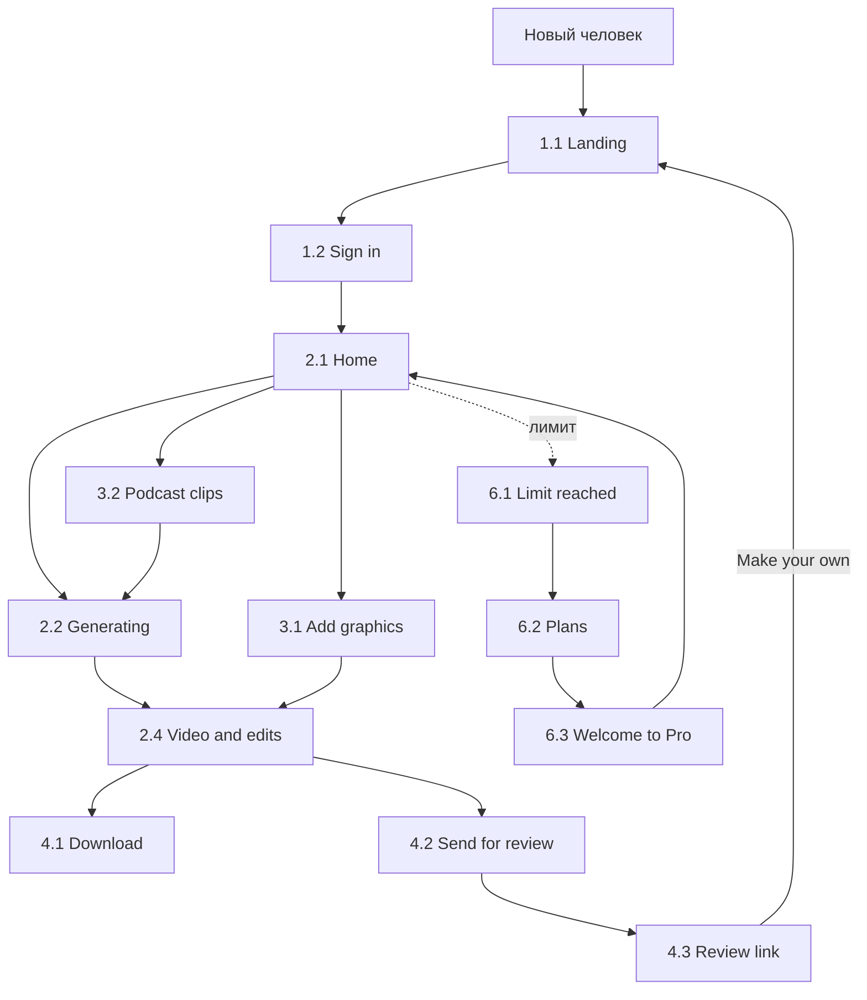
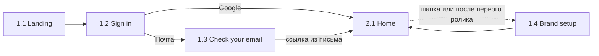
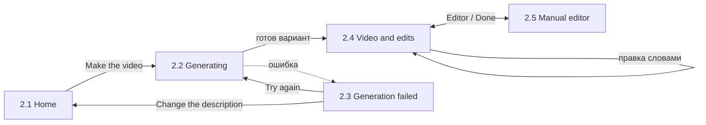

# Пути пользователя

Шесть флоу, как на холсте дизайна. Номера экранов совпадают с `design/screens.md`, картинки в `design/screens/png/`.

## Общая карта

## 1. Вход и настройка

1. Человек приходит на **Landing** (1.1) — с рекламы, из сообщества или по ссылке на чужой ролик.
2. **Sign in** (1.2): Google или ссылка на почту.
3. Если выбрал почту — **Check your email** (1.3), переходит по ссылке из письма.
4. Попадает на **Home** (2.1).
5. **Brand setup** (1.4) не обязателен на старте: его можно открыть из шапки, а после первого ролика сервис сам предложит настроить бренд.

## 2. Сделать ролик

1. На **Home** (2.1) человек пишет, что нужно, или выбирает пример, проверяет формат и длину, жмёт Make the video.
2. **Generating** (2.2): три варианта собираются по очереди. Можно уйти, ролик сохранится.
3. Если не получилось — **Generation failed** (2.3): повторить или поменять описание. Лимит не списывается.
4. **Video and edits** (2.4): выбрать вариант, кликнуть в элемент, сказать, что поменять. Повторять, пока не понравится.
5. При желании — **Manual editor** (2.5) и обратно.
6. Скачать или отправить на согласование (флоу 4).

## 3. Из своего материала

**Готовое видео.** Home → Existing video → загрузка → **Add graphics** (3.1): сервис предлагает места для графики, человек принимает или пропускает → Apply → **Video and edits** (2.4).

**Подкаст.** Home → Podcast → загрузка → **Podcast clips** (3.2): сервис находит моменты, человек оставляет нужные и настраивает длину, формат, субтитры → Make clips → **Generating** (2.2).

Экраны загрузки и анализа не нарисованы.

## 4. Скачать и отправить

- **Download** (4.1): выбрать форматы и качество, дождаться сборки файла, сохранить. Можно закрыть окно — придёт письмо.
- **Send for review** (4.2): включить ссылку, скопировать, отправить коллеге или клиенту.
- **Review link** (4.3): получатель смотрит ролик без входа. Кнопка Make your own ведёт его на лендинг — так ролики приводят новых пользователей.

## 5. Библиотека и аккаунт

- **My videos** (5.1): все ролики, фильтр по формату, открыть любой.
- **My videos, empty** (5.2): первый заход, главная кнопка и примеры.
- **Account** (5.3): профиль, тариф и счётчик роликов, бренд, удаление аккаунта.

## 6. Тарифы и оплата

1. Ролики кончились, человек жмёт Make the video — окно **Limit reached** (6.1). Текст в поле не теряется.
2. Go Pro → **Plans** (6.2): сравнение Free и Pro.
3. Go Pro → страница оплаты платёжного сервиса (не рисуется).
4. После оплаты — **Welcome to Pro** (6.3) → обратно к роликам.

Тарифы также доступны из My videos и Account.
