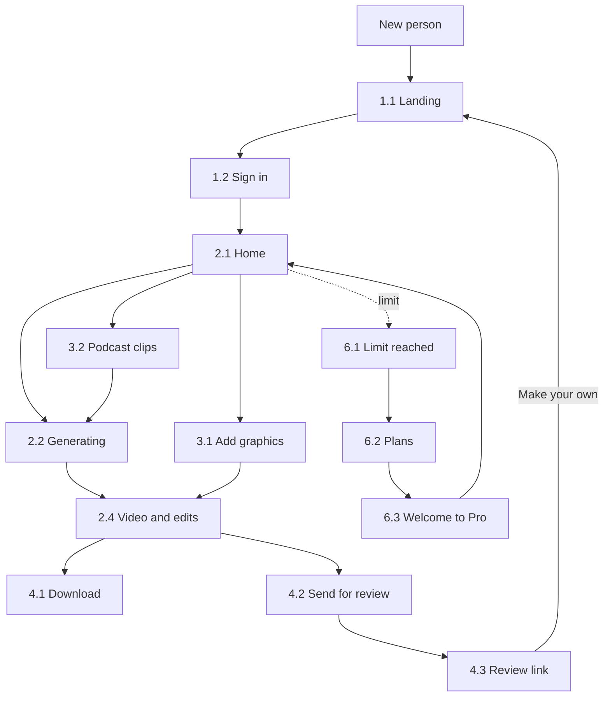
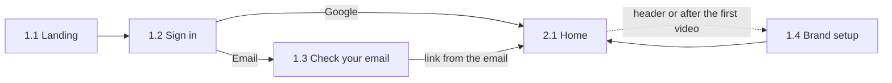
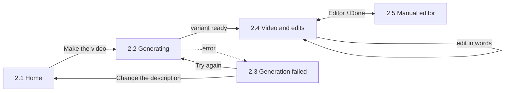

# User flows

Six flows, as on the design canvas. Screen numbers match `design/screens.md`, images are in `design/screens/png/`.

## Overall map

## 1. Sign-in and setup

1. The person arrives at **Landing** (1.1) from an ad, from a community or through a link to someone else's video.
2. **Sign in** (1.2): Google or a link by email.
3. If they chose email, they see **Check your email** (1.3) and follow the link from the email.
4. They land on **Home** (2.1).
5. **Brand setup** (1.4) is not required at the start: it can be opened from the header, and after the first video the service itself will suggest setting up the brand.

## 2. Make a video

1. On **Home** (2.1) the person writes what they need or picks an example, checks the format and length, and presses Make the video.
2. **Generating** (2.2): the three variants are built one after another. You can leave, the video will be saved.
3. If it did not work out, **Generation failed** (2.3): retry or change the description. The limit is not deducted.
4. **Video and edits** (2.4): pick a variant, click an element, say what to change. Repeat until the person is happy with it.
5. If desired, **Manual editor** (2.5) and back.
6. Download or send for review (flow 4).

## 3. From your own material

**Existing video.** Home → Existing video → upload → **Add graphics** (3.1): the service suggests spots for graphics, the person accepts or skips → Apply → **Video and edits** (2.4).

**Podcast.** Home → Podcast → upload → **Podcast clips** (3.2): the service finds moments, the person keeps the ones they need and sets the length, format and captions → Make clips → **Generating** (2.2).

The upload and analysis screens are not drawn.

## 4. Download and send

- **Download** (4.1): choose formats and quality, wait for the file to render, save it. You can close the window and an email will arrive.
- **Send for review** (4.2): turn the link on, copy it, send it to a colleague or a client.
- **Review link** (4.3): the recipient watches the video without signing in. The Make your own button leads them to the landing page. This is how videos bring in new users.

## 5. Library and account

- **My videos** (5.1): all videos, filter by format, open any of them.
- **My videos, empty** (5.2): the first visit, the main button and examples.
- **Account** (5.3): profile, plan and video counter, brand, account deletion.

## 6. Plans and payment

1. The videos have run out, the person presses Make the video and sees the **Limit reached** window (6.1). The text in the field is not lost.
2. Go Pro → **Plans** (6.2): a comparison of Free and Pro.
3. Go Pro → the payment page of the payment service (not drawn).
4. After payment, **Welcome to Pro** (6.3) → back to the videos.

Plans are also available from My videos and Account.
