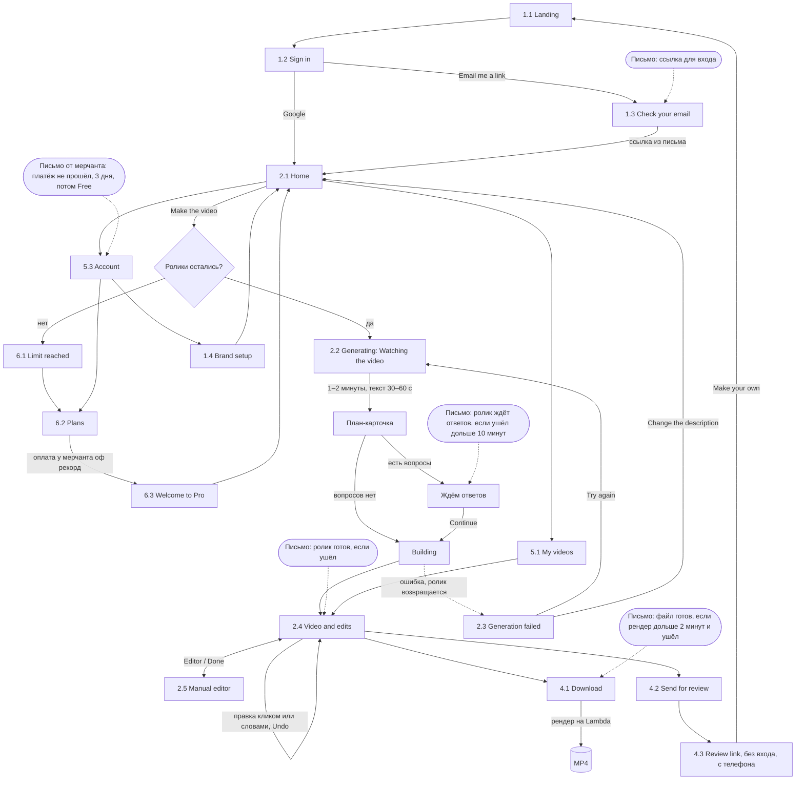

# Путь пользователя

Общая карта первой версии. Узлы это экраны (номера по `design/screens.md`), стрелки это действия, письма отдельными узлами с условиями. Схема меняется в том же коммите, что и поток.

