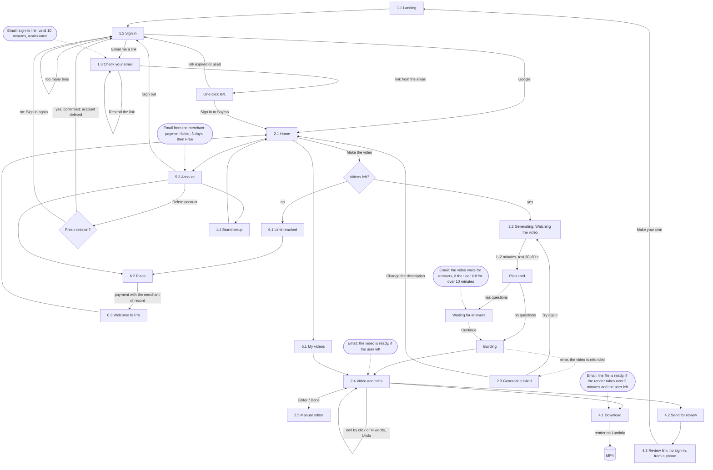

# User flow

The overall map of the first version. Nodes are screens (numbers follow `design/screens.md`), arrows are actions, emails are separate nodes with conditions. The diagram changes in the same commit as the flow.

Sign-in states, built in the first slice of the application:

- **Link sent.** The Check your inbox screen shows the address and a Resend button.
- **Resend.** Sends a new link to the same address.
- **The link's page.** The link opens "One click left." with a Sign in to Saymo button, and only the button signs in: mail filters and link previewers open links before the person does, and a link that signed in on opening would be used up by them. A person who is already signed in goes straight to Home.
- **Expired or used link.** Back on Sign in with a notice that the link has expired. A link without a token, or with a broken one, lands there too.
- **Too many tries.** Requests for a link are limited to 5 per minute; the person sees a notice and tries again later.
- **Google canceled or failed.** Back on Sign in with a notice.

Deleting an account asks for confirmation. If the session is older than a day, a notice asks the person to sign in again first, and then the account can be deleted. After the deletion the person lands on Sign in with a goodbye notice.
