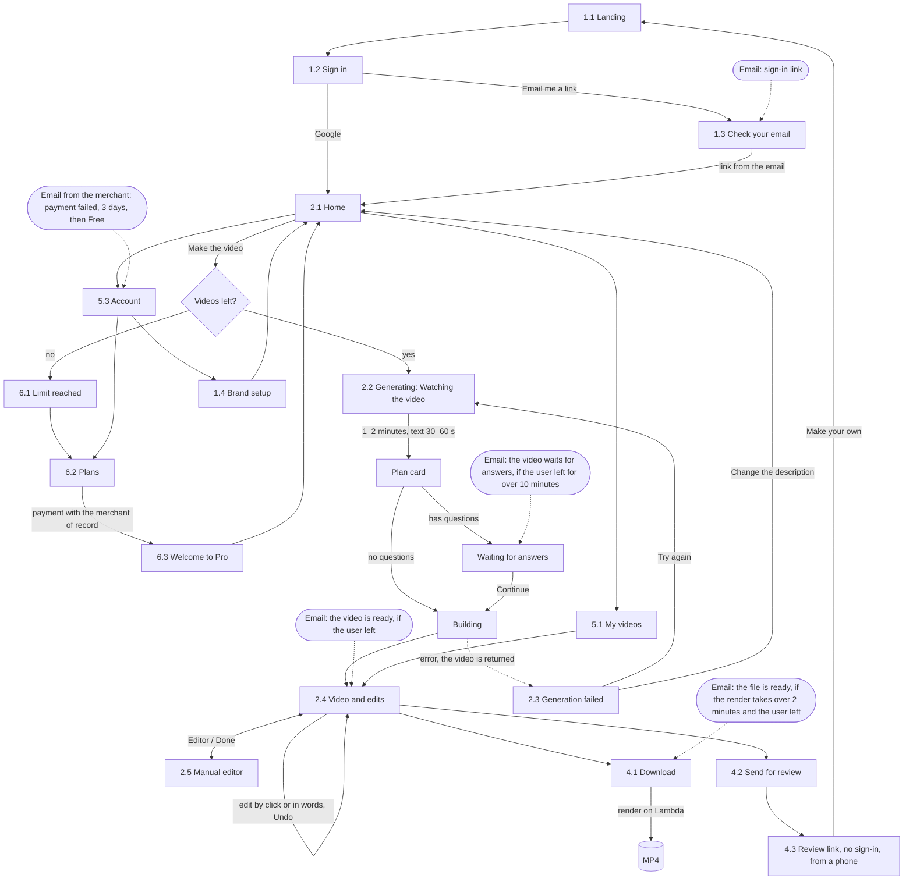

# User flow

The overall map of the first version. Nodes are screens (numbers follow `design/screens.md`), arrows are actions, emails are separate nodes with conditions. The diagram changes in the same commit as the flow.

